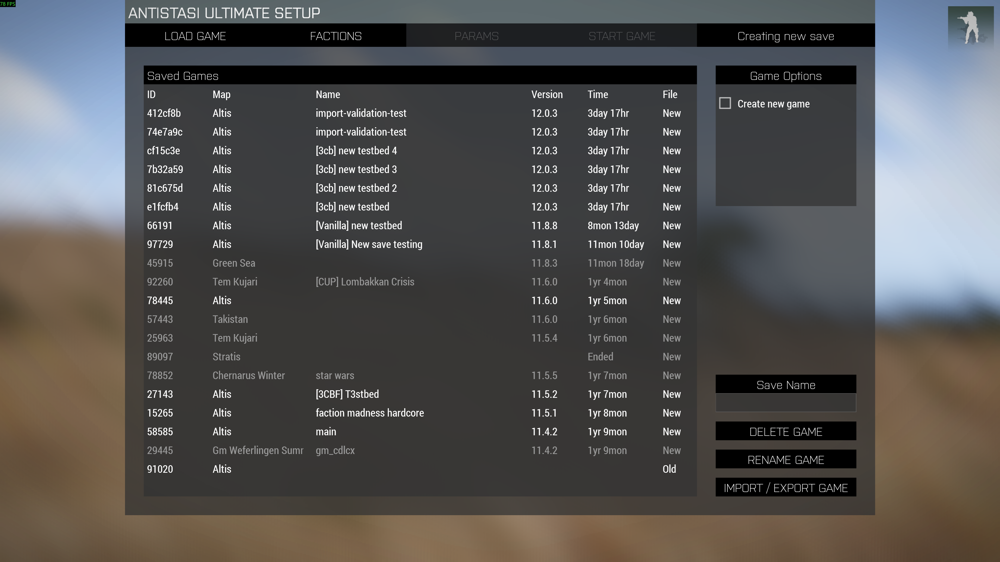
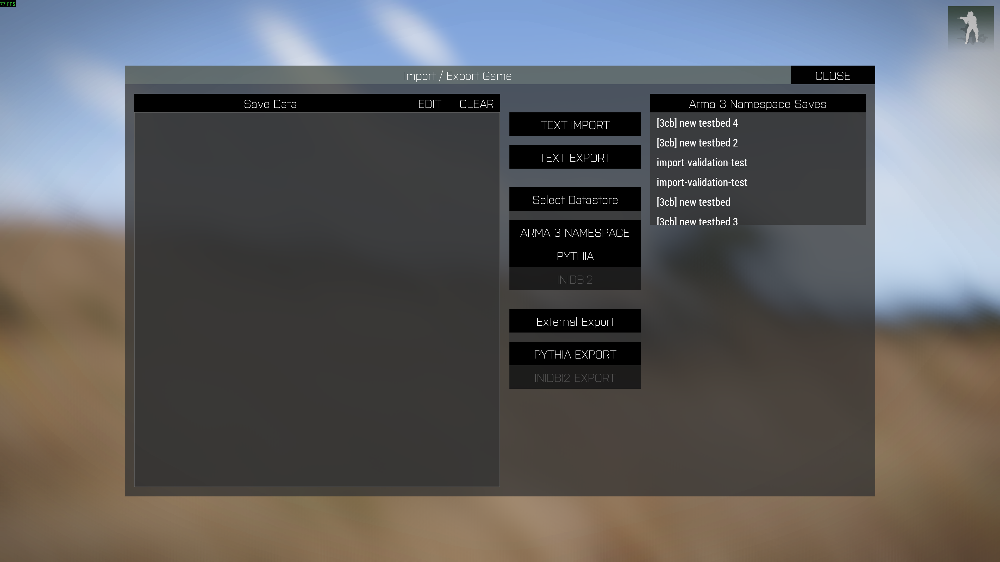
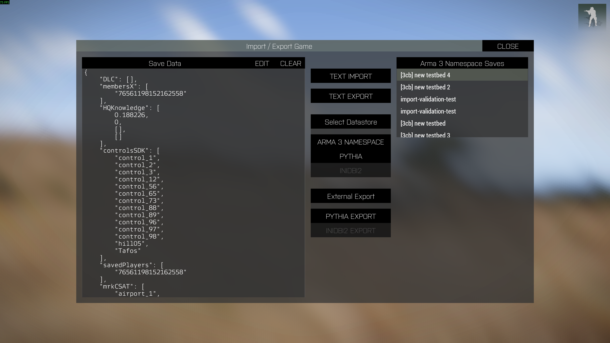
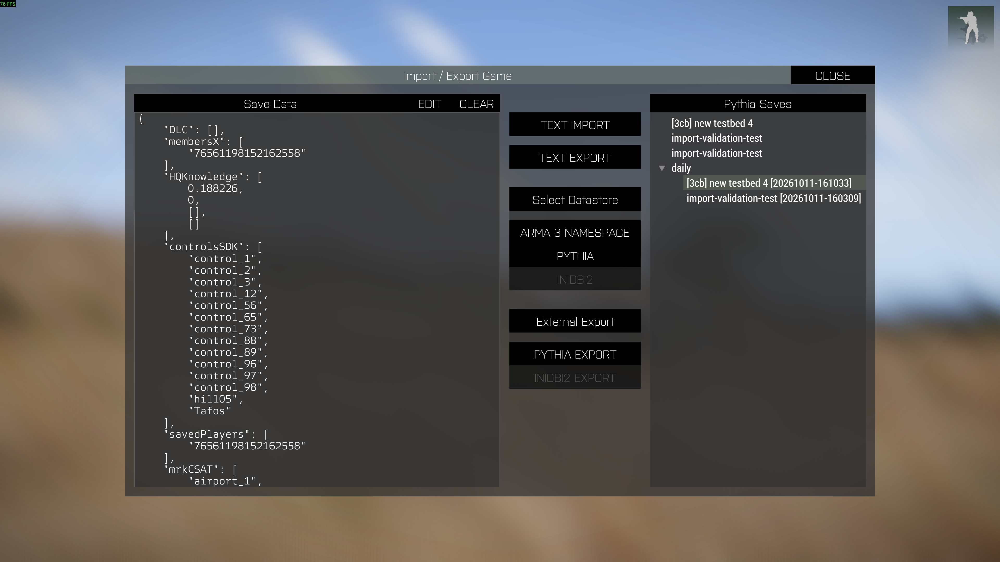

A3UE_EXTSAVES
-------

**Antistasi Ultimate External Saves Extender**

Adds external save file support to [Antistasi Ultimate][url-steam-workshop-a3u]
(A3U). Saves can be exported to, and loaded from, files on your computer's file
system instead of living only inside Arma 3's namespace(s).

> [!WARNING]
> File export and import using the Py3U plugin require the **Pythia** extension, which carries real
> security risks. Read the [Pythia security warning](#pythia-security-warning)
> before installing it.

## Features ##

* **Extended Import / Export dialog** - the A3U Import / Export dialog gains a
  datastore selector (Arma 3 Namespace, Pythia, Inidbi2) and an
  "External Export" section.
* **Export to file** - converts the save data shown in the dialog to JSON and
  writes it to a folder on disk.
* **Load from file** - browse previously exported saves in a tree view and load
  one into the dialog's save data box.
* **Automatic export on save** - an event handler exports the save data every
  time A3U's built-in save system runs (`CBA_EVENT_SERVER_GAME_SAVED`).
* **File retention** - logrotate-style rotation keeps a history of backups
  without filling your disk.

## Status of the plugins ##

| Plugin  | Extension            | Status                                     |
| ------- | -------------------- | ------------------------------------------ |
| Py3U    | [Pythia][url-pythia] | Working. Saves as JSON files.              |
| Inidbi2 | [inidbi2][url-inidbi2] | **Not functional.** Exists only as a stub. |

The **Inidbi2** button, its save list, and the **Inidbi2 Export** button appear
in the dialog but **do nothing yet**. The `exportdata/inidbi2` addon folder is
empty. The plan is for it to store save data in `*.ini` files with
functionality similar to Py3U, but nothing has been implemented. Use the Pythia
option for now.

## Pythia security warning ##

Py3U needs the [Pythia][url-pythia] extension, which lets mods run Python code
inside Arma 3. **Installing and using Pythia is entirely your own decision and
risk.**

* Pythia places **no restrictions** on what Python code can do. Any mod that
  uses Pythia can read, write, or delete files, open network connections, and
  launch programs, with the same permissions as your Arma 3 process (or your
  dedicated server) and your user account.
* **This mod contains no malicious Python code**, and it is small enough to
  audit yourself (see [py3u](@a3ue_extsaves/py3u)). But that says nothing about
  **other** mods you have installed that also use Pythia. Once Pythia is
  loaded, all of them get the same unrestricted access.
* Only run Pythia alongside mods whose authors you trust. Review the Python code
  of any Pythia-based mod you install, and consider using a machine or user
  account that does not hold sensitive data.
* Pythia is a third-party extension and may conflict with anti-cheat. It may
  require BattlEye to be disabled or be rejected by servers that enforce it.
  Check your server's rules before using it.

If you are not comfortable with this, do not install Pythia. The mod still
loads without it, but the Pythia features are unavailable (the Pythia addon is
skipped when its dependency is missing).

## Requirements ##

* [Antistasi Ultimate Mod][url-steam-workshop-a3u] 12.2.0 or newer
* [CBA_A3][url-steam-workshop-cba]
* [Pythia][url-steam-workshop-pythia] ([Source][url-pythia]) (optional, but required for file export and import)

For development only:

* [HEMTT][url-hemtt-dev] - an opinionated Arma 3 build tool
* [Visual Studio Code][url-vscode] (optional)

## Installation ##

1. Install Antistasi Ultimate and CBA_A3.
2. Install Pythia, **after** reading the [security warning](#pythia-security-warning).
3. Load `@a3ue_extsaves` alongside the above mods.

Exports are written by the machine that runs the server: the host in a hosted
game, or the dedicated server.

## How it works ##

```
Import / Export dialog or game save
        |
        v
a3ue_extsaves_exportdata_pythia_fnc_exportData   (SQF, server)
        |   py3_fnc_callExtension
        v
py3u.filesys.write_data                          (Python, via Pythia)
        |
        +- rotate.archive_current  - move the previous export into daily/
        +- write the new JSON file
        +- rotate.rotate           - re-tier and prune archives
```

The addons are:

| Addon                | Purpose |
| -------------------- | ------- |
| `main`               | Shared macros, version, and string definitions. |
| `gui`                | Overrides parts of the A3U Load Game tab and adds the extended Import / Export dialog. |
| `exportdata/pythia`  | SQF side of the Pythia plugin: export function and the game-saved event handler. Requires `PY3_Pythia`. |
| `exportdata/inidbi2` | Placeholder for the future Inidbi2 plugin. Empty. |

The `py3u` folder in the mod root is the Python package Pythia loads (marked by
its `$PYTHIA$` file). `filesys.py` reads and writes files and `rotate.py`
handles retention.

## Usage ##

### Opening the dialog ###

In the A3U setup screen, select the 'Import / Export Game' button.



The dialog opens with an empty save data box:



### Importing a Save ###

This addon does not alter the functionality of save importing from that included in Antistasi Ultimate itself; however, take note of the following important information:

- Only campaigns / saves that have been persistently-saved using Antistasi Ultimate version 12.2.0 or newer will be available for loading into the import / export dialog
- When imported (from any source), a new campaign ID will be generated for the save but the existing name will be retained. The name can then be changed using default Antistasi Ultimate functionality in the load game tab of the setup dialog.

To import a save, there must be valid, JSON-formatted save data in the save data box. To populate this box, either:

1. a. Select a save from the save list on the right side to load a JSON-formatted version of the save data currently stored in Arma 3's native profileNamespace or missionProfileNamespace into the save data box, OR
   
   b. Click the Pythia button to show all save data previously exported by Pythia. Select one of the entries on the right side to load it into the save data box, OR

   c. Paste save data manually into the save data box.
2. Click **Text Import**
3. A hint confirms success or failure.



### Exporting a save ###

1. To export a save, there must be valid, JSON-formatted save data in the save data box. See [Importing a Save](#importing-a-save).
2. 
   a. Click **Text Export** to copy the save data shown to your clipboard for manually pasting wherever you would like to keep it ([only works when local hosting, due to Arma 3 security restrictions](https://community.bistudio.com/wiki/copyToClipboard)), OR

   b. Click **Pythia Export** under "External Export" to export the data to a new `*.json` file.

3. A hint confirms success or failure.

### Loading a save from a file ###

1. Click **Pythia** under "Select Datastore".
2. Pick a save from the "Pythia Saves" tree. Current exports are listed first,
   followed by the `daily`, `weekly`, `monthly`, and `yearly` archives.
   Archived entries show their timestamp in brackets.
3. The JSON is loaded into the save data box, where it can be imported with the
   standard A3U import controls.



Click **Arma 3 Namespace** to go back to the normal save list.

### Automatic export ###

No action is needed. Whenever A3U saves the game, the server reads the save
data from `profileNamespace` or `missionProfileNamespace` (depending on how the
save was made) and exports it just as a manual export would.

## Where your files are ##

Files are written to a folder relative to the working directory of the Arma 3
process that runs the Py3U code:

```
<Arma 3 install folder>\a3ue_extsaves\pythia\
```

For a dedicated server this is the server's own Arma 3 folder; for a hosted or
single player game it is your game folder.

Each save is named after its A3U campaign ID, `A3A_saveData_<campaignID>`, so a
save with campaign ID `74e7a9ca-175d-4f14-827b-94ba956471c5` becomes `A3A_saveData_74e7a9ca-175d-4f14-827b-94ba956471c5.json`.

```
a3ue_extsaves\pythia\
|-- A3A_saveData_74e7a9ca-175d-4f14-827b-94ba956471c5.json                          newest export
|-- daily\    A3A_saveData_74e7a9ca-175d-4f14-827b-94ba956471c5_20261011-134501.json
|-- weekly\
|-- monthly\
`-- yearly\
```

### Retention ###

When a save is exported again, the previous export is moved to `daily/` with a
timestamp taken from its last-modified time. Archives are then sorted into tiers
by age, keeping **one file per period**; extras in the same period are deleted:

| Folder    | File age      | Kept             |
| --------- | ------------- | ---------------- |
| `daily`   | under 7 days  | one per day      |
| `weekly`  | under 28 days | one per ISO week |
| `monthly` | under 365 days | one per month   |
| `yearly`  | older         | one per year     |

Rotation is automatic and permanent. Back the folder up yourself if you need to
keep every version.

## Building ##

This repository is built with [HEMTT][url-hemtt-dev]. Use `hemtt launch` to
test and `hemtt release` to build a ZIP. The version can be changed in
`addons\main\script_version.hpp`.

[url-hemtt-dev]: https://hemtt.dev
[url-steam-workshop-a3u]: https://steamcommunity.com/sharedfiles/filedetails/?id=3020755032
[url-steam-workshop-cba]: https://steamcommunity.com/workshop/filedetails/?id=450814997
[url-pythia]: https://github.com/overfl0/Pythia
[url-steam-workshop-pythia]: https://steamcommunity.com/workshop/filedetails/?id=1751569185
[url-inidbi2]: https://github.com/code34/inidbi2
[url-steam-workshop-inidbi2]: https://steamcommunity.com/workshop/filedetails/?id=1768992669
[url-vscode]: https://code.visualstudio.com/
